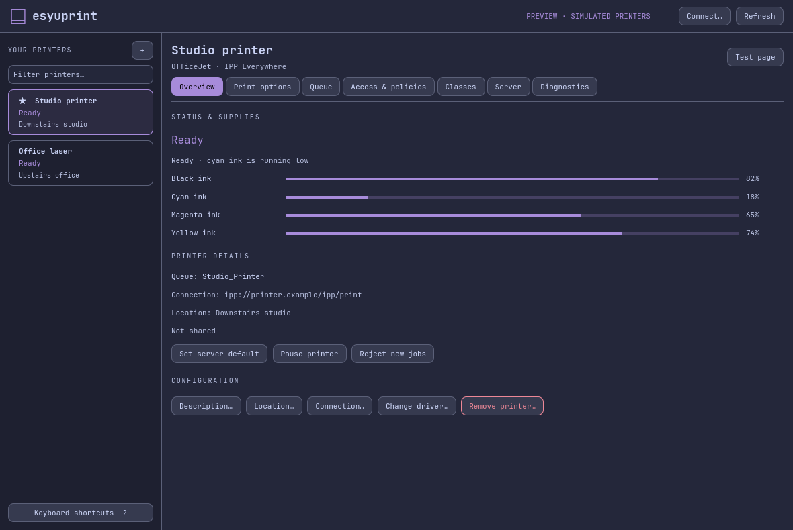
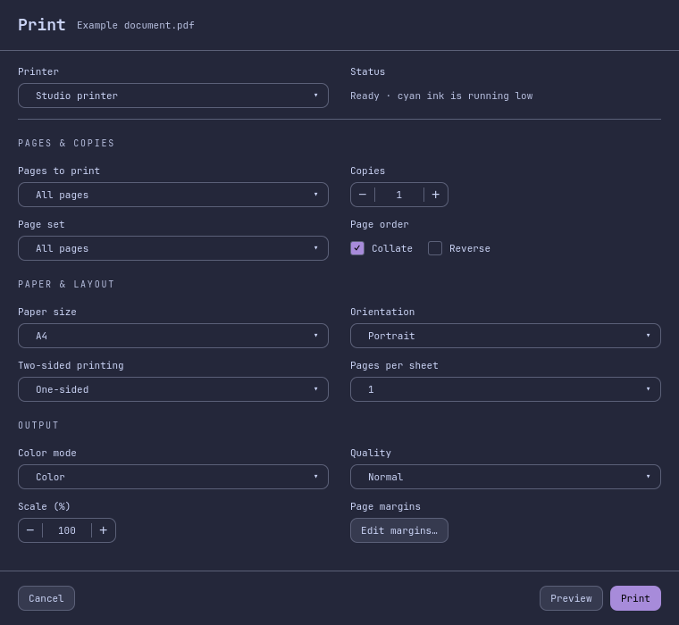

# esyuprint

A small printer manager and print dialog that follow your Omarchy theme.

**Vibecoded with AI for my personal use.** Experimental software, provided as-is;
review it before trusting it with your printers. Support and compatibility are
not guaranteed.

Built for my **2021 M1 Pro MacBook Pro running Omarchy (Arch Linux ARM +
Hyprland)**, not native macOS. Linux ARM64 is my setup; x86_64 packaging is
included but has not been hardware-tested by me.

## A look inside



Manage printers, ink levels, print options and queues through the existing CUPS
backend. Changes ask for confirmation.



The optional Print portal provides a centered, two-column dialog for applications
that use portal printing. It cannot replace every browser's built-in dialog.
Screenshots use demo data; no private documents or device identities.

## Build and run

Requires Qt 6, CUPS and the system dependencies in [PKGBUILD](pkgbuild/PKGBUILD).
Development uses [mise](https://mise.jdx.dev/):

```sh
mise install
mise run setup
mise run build
./build/esyuprint open
```

`make package` builds an Arch package; `make install` installs it with authorization.
See the [usage and portal setup guide](docs/usage.md) for configuration and limits.
On Hyprland, the print-only window rule in that guide keeps the dialog floating.

## Development and contributions

```sh
mise run format
mise run check       # fast checks
mise run check-all   # full checks; no physical print jobs
```

Fork the repo, make a focused branch, and open a pull request with a short
explanation, checks run, and screenshots for UI changes. Issues and PRs are
welcome, but this remains a personal project. Never include credentials, real
documents or private printer addresses in reports or test fixtures.

Scanning companion: [esyuscan](https://github.com/AyeCaptn/esyuscan).

GPL-2.0-or-later. See [LICENSE](LICENSE) and [upstream notices](THIRD-PARTY.md).
